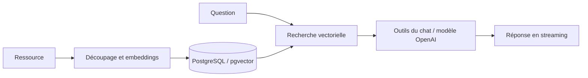

# RAG Starter — Assistant documentaire

Prototype d’assistant connecté à une base de connaissances. Il combine une interface de chat Next.js, la création d’embeddings OpenAI et une recherche vectorielle dans PostgreSQL avec pgvector.

[Voir la démonstration](https://ai-sdk-rag-starter-one.vercel.app) · [Guide d’origine](docs/UPSTREAM-README.md)

## Fonctionnement

1. Le contenu d’une ressource est découpé en segments à partir des phrases.
2. Le serveur génère des embeddings et stocke les segments dans PostgreSQL.
3. Une question est convertie en vecteur puis comparée aux contenus enregistrés.
4. Les outils du chat récupèrent le contexte et le modèle produit une réponse en streaming.

Le code utilise `text-embedding-ada-002` pour les embeddings et `gpt-4o` pour le chat. La recherche retient jusqu’à quatre segments avec une similarité supérieure à 0,5. Ces paramètres sont des choix du prototype, à évaluer sur un corpus réel.



## Stack

Next.js 14 · TypeScript · Vercel AI SDK · OpenAI · Drizzle ORM · PostgreSQL / pgvector · Tailwind CSS · shadcn/ui.

## Démarrage local

```bash
git clone https://github.com/ddesilias/nextjs-rag-starter.git
cd nextjs-rag-starter
pnpm install
cp .env.example .env
```

Renseigner `DATABASE_URL` et `OPENAI_API_KEY` dans `.env` (chargé aussi par le script de migration). La base doit prendre en charge pgvector. Sur Vercel, `POSTGRES_URL` est accepté si `DATABASE_URL` est absent. Les identifiants restent côté serveur.

Appliquer les migrations à une base de développement dédiée, puis démarrer :

```bash
pnpm db:migrate
pnpm dev
```

`pnpm db:generate` sert à générer une nouvelle migration après modification du schéma. Ne pas appliquer des migrations à une base de production sans examen.

## Repères dans le code

| Emplacement | Responsabilité |
| --- | --- |
| `lib/ai/embedding.ts` | Découpage, embeddings et recherche par similarité cosinus |
| `lib/db/schema` | Schéma des ressources et des embeddings |
| `lib/actions` | Actions de gestion des ressources |
| `app/api/chat/route.ts` | Modèle, outils et réponse en streaming |
| `lib/env.mjs` | Validation de la configuration PostgreSQL |

## Validation et limites

La vérification TypeScript passe. La configuration a été contrôlée pour la priorité de `DATABASE_URL`, le remplacement par `POSTGRES_URL` et le refus d’une configuration sans connexion PostgreSQL. La page publique est accessible ; aucun appel IA payant ni ajout de données n’a été effectué pour cette vérification.

La qualité des réponses, la pertinence du seuil de recherche et les contrôles d’accès demandent une évaluation dédiée avant un usage avec des documents confidentiels. Le contexte récupéré ne garantit pas l’exactitude d’une réponse.

## Origine du projet

Ce dépôt reprend le starter du **guide RAG du Vercel AI SDK**. La [documentation antérieure](docs/UPSTREAM-README.md) conserve cette attribution. Le projet est présenté comme une adaptation et une expérimentation de cette base.
